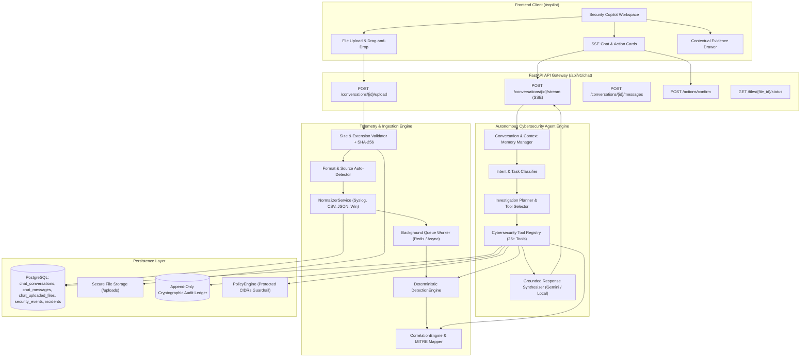
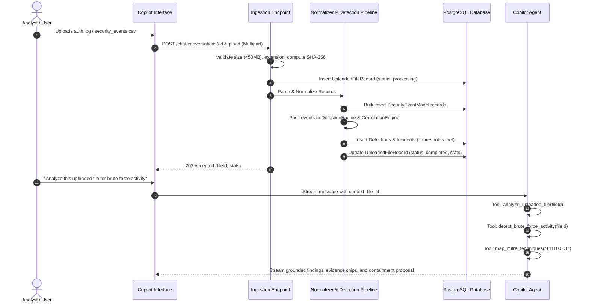

# SENTINEL AI — AUTONOMOUS CYBERSECURITY CHATBOT ARCHITECTURE
## Technical Architecture, Component Audit & Integration Specification

---

### 1. Executive Summary & Mission Scope

SENTINEL AI is transitioning to place its **Security Copilot** as the primary autonomous interaction and investigation layer. Rather than operating as an isolated chat interface or a cosmetic LLM wrapper, the chatbot is architected as an autonomous AI cybersecurity analyst capable of:
1. Natural language communication and context-aware follow-up reasoning.
2. Ingesting, parsing, and normalizing uploaded cybersecurity datasets, raw server logs, and telemetry files (CSV, JSON, JSONL, TXT, LOG, RFC 5424 Syslog, Windows 4625/4624, PAM, Okta).
3. Executing bounded cybersecurity investigation tools across telemetry, detection alerts, incident correlations, threat intelligence, and audit trails.
4. Performing autonomous log investigations that detect credential attacks, privilege escalation, and lateral movement with zero hallucination.
5. Formulating explainable, evidence-backed security reports mapped to the MITRE ATT&CK framework.
6. Initiating controlled defensive response actions governed by `PolicyEngine` guardrails, human authorization gates, and append-only cryptographic audit logging.

---

### 2. Current System Audit: What Exists vs What is Missing

| Component / Layer | Existing Implementation | Audit Status | Required Enhancements |
| :--- | :--- | :--- | :--- |
| **Persistence & Models** | `chat_conversations`, `chat_messages` tables; SQLAlchemy 2.x; Alembic migrations. | ✅ Operational | Add `chat_uploaded_files` model and Alembic migration to track uploaded log files, SHA-256 hashes, parsing metrics, and detection associations. |
| **Log Parsing & Normalization** | `NormalizerService` in `ingest.py` parses RFC 5424, OpenSSH, PAM, Okta JSON, Windows 4625. | ✅ Functional | Extend to accept multi-format file uploads (CSV, JSONL, multi-line logs), auto-detect format, parse batches, and store normalized events linked to investigations. |
| **Detection Engine** | `DetectionEngine` in `detection.py` (SSH brute-force, password spray, distributed attacks). | ✅ Verified deterministic | Hook directly into file ingestion pipeline so uploaded files trigger real detections. |
| **Correlation & Risk** | `CorrelationEngine` in `correlation.py` calculates risk scores (0-100) and maps MITRE techniques. | ✅ Verified deterministic | Expose correlation as agent tools for incident investigation and attack sequence reconstruction. |
| **Threat Intelligence & RAG** | `knowledge_retriever` (MITRE & playbooks), `threat_intel_service` with reputation cache. | ✅ Operational | Expose IP lookup, reputation check, and ATT&CK mapping as agent tools. |
| **SOAR & Response Safety** | `PolicyEngine` enforces protected CIDR blocks (`127.0.0.0/8`, `10.240.0.0/24`), dry-runs, rollback. | ✅ Verified safety | Integrate response tools: `create_incident`, `propose_response_action`, `simulate_response_action`, `execute_approved_response_action`. |
| **AI / LLM Integration** | `GeminiProvider` and `LocalDeterministicProvider` in `analyst.py`. | ⚠️ Partially utilized in chat | Unify agent reasoning: route chat synthesis through `GeminiProvider` when configured, with graceful fallback to `LocalDeterministicProvider`. Never fabricate AI responses. |
| **Tool Calling Suite** | 5 simple read methods in `ChatTools`. | ⚠️ Incomplete | Implement complete suite of 25+ bounded cybersecurity tools across log analysis, investigation, system intelligence, and response. |
| **File Upload Pipeline** | Missing endpoint for chat uploads. | ❌ Missing | Implement `POST /api/v1/chat/conversations/{id}/upload` with size checks, SHA-256, format detection, background worker execution, and status polling. |
| **Context & Investigation Memory**| Basic conversation message history. | ⚠️ Incomplete | Implement multi-turn state tracking (active target IP, active incident, active uploaded file) to handle follow-up queries naturally. |
| **Frontend Integration** | 3-column Copilot UI at `/copilot`. | ⚠️ Partial | Add file upload button, drag-and-drop zone, ingestion progress indicators, and quick query pills for uploaded files. |

---

### 3. Target End-to-End Architecture

---

### 4. Cybersecurity Tool Registry Specification

Every tool is implemented with explicit Pydantic schema validation, permission checks, execution timeouts, error handling, and structured evidence references.

#### A. Log Analysis Tools
1. `analyze_uploaded_file`: Inspects an uploaded file by ID, retrieves parsing metrics, detection alerts, and summary.
2. `parse_security_logs`: Parses raw log text on the fly using `NormalizerService`.
3. `get_authentication_events`: Queries authentication successes, failures, and challenge events with filters.
4. `search_security_events`: Bounded full-text and field search over ingested security events.
5. `detect_brute_force_activity`: Evaluates high-frequency authentication failures targeting specific accounts or services.
6. `detect_suspicious_login_patterns`: Identifies anomalous login timings, user-agent anomalies, or off-hours authentications.
7. `identify_privilege_escalation`: Detects authentication attempts transitioning from standard users to `root`, `admin`, or `deploy`.
8. `analyze_network_connections`: Analyzes unique source/destination IP pairs, ports, and connection frequencies.
9. `correlate_security_events`: Groups events by correlation ID, IP, or time window.

#### B. Investigation Tools
1. `investigate_ip_address`: Forensic dossier on an IP address (events, outcomes, threat intel, reputation score, ASN).
2. `investigate_user_activity`: Analyzes all activity, workstations, and failure ratios for a target username.
3. `investigate_incident`: Retrieves complete incident details, correlated event timeline, risk score, and assigned playbooks.
4. `get_related_detections`: Retrieves detections triggered by specific IPs, users, or rule categories.
5. `get_incident_timeline`: Reconstructs chronological attack sequence for an incident.
6. `get_attack_sequence`: Extracts ordered sequence of stages (initial access → credential access → execution).
7. `map_mitre_techniques`: Queries MITRE ATT&CK techniques, tactics, detection guidelines, and reference URLs.
8. `retrieve_threat_intelligence`: Retrieves external or cached threat intelligence indicators and tags.

#### C. System Intelligence Tools
1. `get_security_overview`: Global metric summary: event totals, active incidents, open detections.
2. `get_active_incidents`: Lists unresolved incidents sorted by severity and risk score.
3. `get_detection_summary`: Aggregates detections by category, severity, and rule name.
4. `get_recent_events`: Retrieves latest normalized telemetry records.
5. `get_system_health`: Evaluates forwarder statuses, ingestion stream rates, database connectivity, and defense toggle.
6. `get_audit_history`: Retrieves recent cryptographically verified audit records.

#### D. Response Tools
1. `create_incident`: Promotes confirmed suspicious activity into a tracked formal Incident.
2. `generate_investigation_report`: Formulates a structured incident summary with evidence references.
3. `propose_response_action`: Stages a defensive action proposal evaluated against `PolicyEngine`.
4. `simulate_response_action`: Executes dry-run sandbox validation of a playbook action without changing production state.
5. `execute_approved_response_action`: Executes an analyst-authorized countermeasure via `response_service` and signs the audit ledger.

---

### 5. Multi-Step File Ingestion & Log Investigation Pipeline

---

### 6. Implementation Sequence

1. **Database Model & Migration**:
   - Create `UploadedFileModel` in `backend/app/models/chat.py`.
   - Author Alembic migration `backend/alembic/versions/` for `chat_uploaded_files`.
2. **File Ingestion Engine**:
   - Create `backend/app/services/file_ingest.py` supporting CSV, JSON, JSONL, TXT, LOG, RFC 5424, Windows, PAM, Okta.
   - Implement file storage, SHA-256 deduplication, record normalization, and detection linking.
   - Add endpoint `POST /api/v1/chat/conversations/{id}/upload` in `backend/app/api/v1/chat.py`.
3. **Cybersecurity Tool Registry**:
   - Implement `backend/app/services/chat_tools.py` with the complete 25+ tools, input/output schemas, validation, and error boundaries.
4. **Agent Orchestration & Generative AI Integration**:
   - Enhance `ChatCopilotService` in `backend/app/services/chat.py` with:
     - Task & intent classification.
     - Multi-turn context memory (active IP, active incident, active file).
     - Tool execution and result collection.
     - Synthesis through `GeminiProvider` when configured, and deterministic local engine fallback.
     - Streaming SSE delivery with real investigation stages.
5. **Frontend Copilot Enhancement**:
   - Add file upload UI (dropzone, upload button, upload status indicators) in `src/features/copilot/`.
   - Update `useChatStore.ts` and `sentinelApi.chat` to support file uploads and file status tracking.
6. **Testing & Verification**:
   - Write comprehensive tests in `backend/tests/test_autonomous_agent.py` and `test_file_ingest.py`.
   - Verify quality gates, frontend build, and live browser execution.
