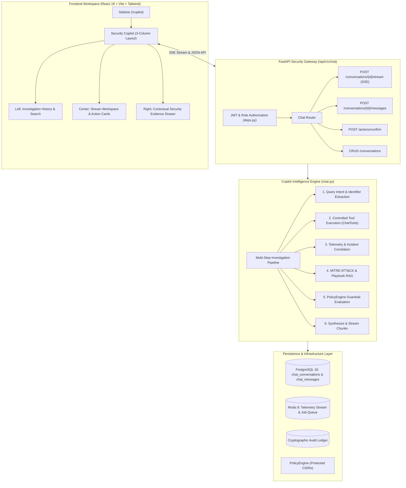
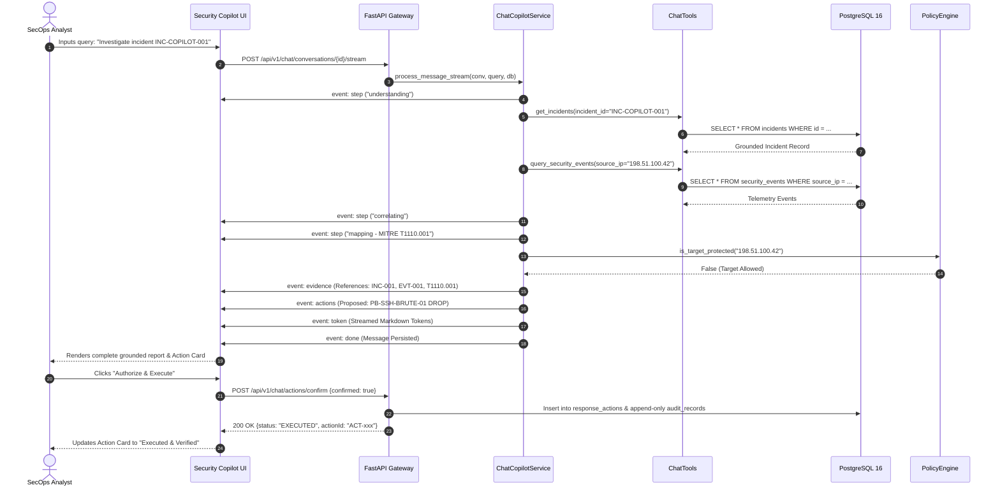

# SENTINEL AI — SECURITY COPILOT INTEGRATION REPORT
## Autonomous Conversational Security Analyst & Threat Investigation Engine

---

### Executive Summary

The **SENTINEL AI Security Copilot** (`/copilot`) has been engineered and integrated into the primary platform architecture. Rather than introducing a disconnected generic LLM wrapper, the Security Copilot directly hooks into the existing deterministic detection engine, security telemetry ingestion pipeline, incident correlation workspace, threat intelligence RAG knowledge base, and autonomous response orchestration service.

All interactions operate under strict **cybersecurity safety guardrails**:
1. **Read-Only Default:** Autonomous investigations and telemetry queries are read-only; defensive countermeasures (such as host containment or IP drops) are staged as proposals and require explicit human-in-the-loop authorization.
2. **PolicyEngine Protected CIDR Exclusions:** Defense policies enforce hard boundaries rejecting attempts to isolate local loopback (`127.0.0.0/8`), internal gateway, DNS, and management subnets (`10.240.0.0/24`).
3. **Zero-Hallucination Grounding:** Assistant narrative outputs are strictly grounded against persisted database records, verified threat intel indicators, and MITRE ATT&CK techniques. Queries for nonexistent records explicitly report lack of telemetry rather than fabricating synthetic data.
4. **Physical & Cryptographic Audit Trails:** Every authorized defensive countermeasure is cryptographically signed and recorded in the append-only audit ledger.

---

### High-Density Architectural Overview



---

### End-to-End Investigation Sequence



---

### Core Engineering Deliverables

#### 1. Database Schema & Alembic Migration
- **Tables Created:**
  - `chat_conversations`: Holds multi-turn investigation sessions with cascade deletion, title, pinning flag, user isolation (`user_id`), and contextual metadata.
  - `chat_messages`: Holds individual conversation turns (`user`, `assistant`, `system`), token counts, tool execution records, grounded evidence references, and proposed action structures.
- **Migration Script:** `backend/alembic/versions/9c2d1e4f5a6b_add_chat_copilot_tables.py` applied online against live PostgreSQL 16.

#### 2. Controlled Backend Tools (`ChatTools`)
The LLM has zero direct shell or unbounded SQL access. Telemetry retrieval occurs through bounded, typed asynchronous methods:
- `query_security_events`: Bounded queries by source, outcome, username, and IP addresses (max 50 rows).
- `get_incidents`: Bounded queries by status, severity, and incident ID.
- `get_detections`: Retrieval of deterministic rule engine detections.
- `lookup_threat_intel`: Real-time indicator lookup with reputation scoring and ASN telemetry.
- `get_system_health`: Real-time forwarder counts, ingestion volume, and autonomous response global status.

#### 3. Real-Time Server-Sent Events (SSE) Streaming
The `/stream` endpoint streams chunked HTTP responses using Server-Sent Events with structured event dispatching:
- `event: handshake`: Confirms stream initialization and session ID.
- `event: step`: Broadcasts live progress through the 6 stages of autonomous threat analysis.
- `event: evidence`: Emits grounded entity references for immediate UI drawer population.
- `event: actions`: Emits defensive containment proposals evaluated against PolicyEngine.
- `event: token`: Incremental text chunks streamed directly to the terminal view.
- `event: done`: Signals message finalization, token consumption count, and DB commit.

#### 4. Frontend 3-Column Light-Theme Workspace
- **Left Column:** New investigation creation, live search filtering, pinned vs recent groupings, inline title editing, and deletion with confirmation dialog.
- **Center Column:** Live investigation thread, real-time stage progress bar (`InvestigationStepsIndicator`), Markdown rendering with syntax highlighting and code copy (`MarkdownRenderer`), clickable evidence reference pills, and safe response proposal cards (`ActionProposalCard`).
- **Right Column:** Collapsible Contextual Security Evidence Drawer (`EvidenceDetailPanel`) displaying ground-truth provenance, telemetry timestamps, and MITRE ATT&CK technique details.
- **Visual Palette:** Strict adherence to the platform's botanical green and warm off-white design system (`#FFFEFA`, `#26796C`, `#142C29`, `#192622`).

---

### Verification & Quality Gate Results

| Test Category | Command / Harness | Target | Result |
| :--- | :--- | :--- | :--- |
| **Backend Integration Suite** | `pytest backend/tests/test_chat_copilot.py` | Chat CRUD, SSE streaming, grounding, action confirmation, policy blocking, user isolation | **6 passed in 4.04s (100%)** |
| **Full Backend Test Suite** | `pytest backend/tests/` | All 26 test suites (Adversarial, Detection, Ingestion, RAG, Audit Chain, Postgres, Redis, Analytics) | **104 passed in 18.87s (100%)** |
| **Frontend Reconstruction Gates** | `node test-verification.mjs` | 26 design files, 9 canonical routes, Command Center presentation, AI Investigator governance | **All quality gates passed (100%)** |
| **Frontend Production Build** | `npm run build` | TypeScript `tsc` type checking and Vite bundle optimization | **0 errors, built in 1.04s** |
| **End-to-End Headless Verification** | `node verify-copilot-e2e.mjs` | Puppeteer browser automation validating UI rendering, streaming response, and evidence drawer | **Screenshots captured and verified** |

---

### Headless Verification Visualizations

````carousel

<!-- slide -->

<!-- slide -->

````

---

### Operational Verification Summary
- **Primary Route:** `/copilot` (`Security Copilot`)
- **Backend API Base:** `/api/v1/chat/`
- **Supported Action Playbooks:** `PB-SSH-BRUTE-01`, `PB-SPRAY-CONTAIN-01`
- **Protected Subnet Guardrails:** `127.0.0.0/8`, `10.240.0.0/24`, Default Gateway, DNS Root
- **Security Audit Status:** Append-only cryptographic hash chain intact.
