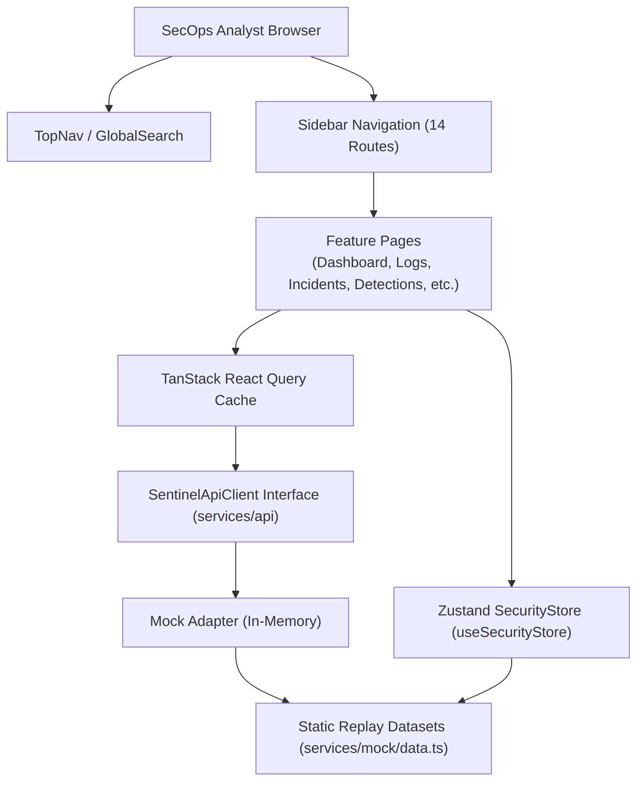
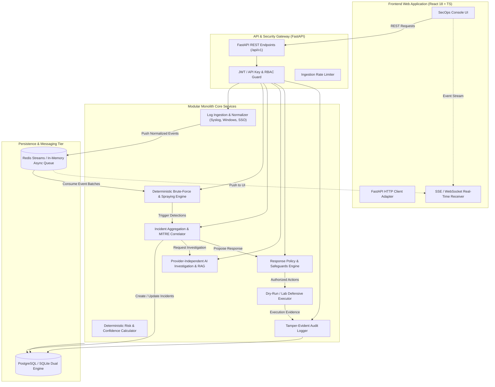

# SENTINEL AI — Current & Target Architecture Specification

**Document Version:** 1.0.0  
**Date:** October 31, 2026  
**Status:** ARCHITECTURAL SPECIFICATION

---

## 1. Current Architecture (As-Is)

The current SENTINEL AI platform runs strictly as a single-page client-side web application in the user's browser:

### Key Architectural Traits:
1. **Presentation Tier:** React 18 with Vite 6 bundler and Tailwind CSS.
2. **State Tier:** Zustand store holding events, detections, incidents, actions, and audit records in client memory.
3. **Transport Tier:** `SentinelApiClient` abstraction layer in `src/services/api/index.ts`. All methods are `async` and return promises, facilitating seamless cutover to an HTTP/REST backend.
4. **Data Tier:** In-memory static arrays created upon app bootstrap. Changes (e.g. status updates, playbook test triggers) persist only in browser RAM until refreshed.

---

## 2. Target Architecture (To-Be Modular Monolith)

To meet the mission requirements without unnecessary distributed system complexity, SENTINEL AI is designed as a **Modular Monolith** with an asynchronous processing pipeline powered by FastAPI, SQLAlchemy 2.x, PostgreSQL/SQLite, and Redis Streams / Async Queue:

---

## 3. Subsystem Breakdown

### 3.1. API & Security Layer (`backend/app/api`)
- **FastAPI Framework:** Strict typing, OpenAPI documentation, Pydantic v2 schemas.
- **Authentication:** Stateless signed JWTs with expiration, bearer tokens, and configurable static API keys for log forwarders.
- **Role-Based Access Control (RBAC):**
  - `admin`: Full configuration, policy modification, emergency halt, response execution.
  - `analyst`: Incident triage, manual response execution, AI investigation query.
  - `auditor`: Read-only access to audit trail and compliance reports.
  - `forwarder`: Ingest-only access for log shipping agents.

### 3.2. Log Ingestion & Normalization (`backend/app/ingest`)
- **Supported Formats:**
  - Linux `sshd` Syslog (RFC 3164 / RFC 5424).
  - Linux PAM authentication logs.
  - Windows Security Events (Event ID 4625 failed, 4624 success).
  - App SAML / SSO Gateway authentication JSON logs.
  - Nginx access logs.
- **Normalization Pipeline:**
  - Extracts timestamp, source IP, destination IP/port, username, auth outcome, authentication method, failure reason, and session identifiers.
  - Emits canonical `SecurityEvent` schema.
  - Computes event SHA-256 fingerprint for deduplication.

### 3.3. Deterministic Detection Engine (`backend/app/detection`)
- **Philosophy:** Runs completely **without AI/LLMs**. Fully deterministic, auditable, and mathematically reproducible.
- **Detection Heuristics:**
  1. **SSH Brute Force:** Rolling window algorithm. Triggers when $N$ failures occur from the same `source_ip` within $W$ seconds.
  2. **Horizontal Password Spraying:** Triggers when 1 source IP attempts authentications against $\ge K$ unique usernames within $W$ seconds.
  3. **Distributed Brute Force:** Triggers when $\ge M$ distinct source IPs target the same username within $W$ seconds.
  4. **Suspicious Successful Authentication:** Triggers when a successful login occurs from an IP address that previously registered $\ge N$ failed attempts within the preceding window.

### 3.4. Incident Management & Correlation (`backend/app/incidents`)
- Correlates individual detections sharing matching attacker IPs, target hosts, or time envelopes into unified `Incident` records.
- Automatically links supporting event IDs as cryptographic evidence.
- Maps attack patterns to MITRE ATT&CK techniques (`T1110.001`, `T1110.003`, `T1078.003`).

### 3.5. Risk Assessment Engine (`backend/app/risk`)
- Deterministic scoring formula:
  $$\text{RiskScore} = \min(100, \, \text{BaseSeverity} + \text{VelocityPenalty} + \text{PrivilegeWeight} + \text{SuccessBreachFactor})$$
- Distinguishes confidence score (statistical certainty of the attack pattern) from risk score (potential organizational damage).

### 3.6. AI Investigation Subsystem (`backend/app/analyst`)
- **Provider-Independent Interface:** Clean abstract base class (`LLMProvider`) supporting Google Gemini API, OpenAI, or local synthetic fallback.
- **Grounding & Evidence Integrity:** The LLM prompt is injected with exact normalized security event objects.
- **Constraints:**
  - AI responses must reference real, existing `eventId` values.
  - AI is strictly prohibited from invoking response actions directly.
  - Structured output validated via Pydantic v2 schemas.

### 3.7. Autonomous Response & Policy Engine (`backend/app/response`)
- **Policy Engine (OPA-style Guardrails):**
  - **Protected IP Allowlist:** Hard checks prevent any action against internal DNS, domain controllers, default gateways, or user workstations.
  - **Action Allowlists:** Only explicitly registered actions (`iptables_drop`, `terminate_session`, `rate_limit_ip`) are valid.
  - **Budget Limits:** Maximum actions per hour to prevent denial-of-service through self-inflicted isolation.
  - **Global Emergency Kill Switch:** One-click disable that immediately aborts all automated containment.
- **Execution Adapters:**
  - `DryRunExecutor` (Default): Logs proposed command, parameters, and simulated outcome.
  - `LabIsolatedExecutor`: Executes real network containment within isolated container networks / enrolled test assets only.
- **Verification & Rollback:** Every executed action schedules an expiration check and automatic rollback unless explicitly made permanent by an analyst.

### 3.8. Audit Subsystem (`backend/app/audit`)
- Append-only event log capturing:
  - Detection matches.
  - AI investigation requests and summaries.
  - Risk calculations.
  - Policy decisions (approved or rejected).
  - Defensive execution attempts and verification results.
  - Configuration changes.
- Exportable to structured JSON.
