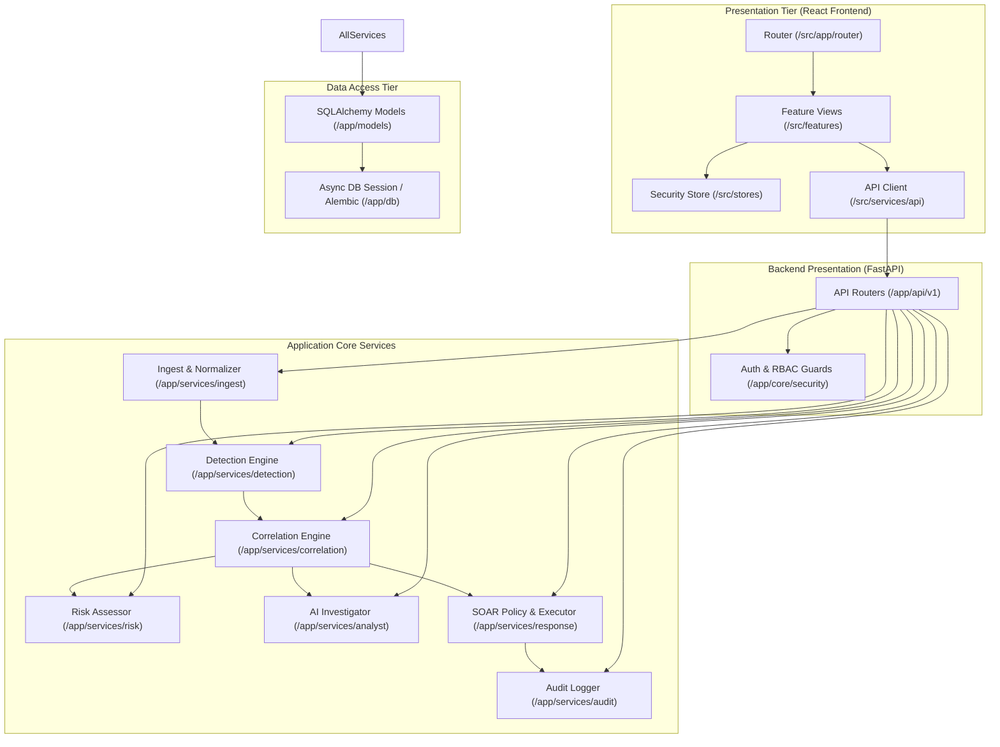

# SENTINEL AI — Dependency Map

**Document Version:** 1.0.0  
**Date:** October 31, 2026  
**Status:** VERIFIED SPECIFICATION

---

## 1. Frontend Dependencies (`package.json`)

| Package | Version | Purpose | Security & Architecture Note |
|---|---|---|---|
| `react` | `^18.3.1` | Core UI library | Modern concurrent rendering, hooks |
| `react-dom` | `^18.3.1` | DOM renderer | Browser rendering |
| `react-router-dom` | `^6.28.0` | Client-side routing | Browser routing, `createBrowserRouter` |
| `zustand` | `^5.0.1` | Global client state | Minimal footprint, reactive subscriber store |
| `@tanstack/react-query` | `^5.62.0` | Server-state caching | Async state caching, automatic refetch, retry |
| `lucide-react` | `^0.462.0` | UI iconography | Clean SVG icons for SecOps indicators |
| `recharts` | `^2.13.3` | Data visualization | SVG charting for telemetry volume and distributions |
| `clsx` | `^2.1.1` | Conditional classes | Utility for Tailwind class concatenation |
| `tailwind-merge` | `^2.5.5` | CSS class deduplication | Merges conflicting Tailwind utility classes |
| `tailwindcss` | `^3.4.16` | Utility-first CSS | Design token management and dark styling |
| `vite` | `^6.0.1` | Frontend build tool | ESM dev server and Rollup production bundler |
| `typescript` | `^5.6.3` | Static type checker | Strict compile-time validation |

---

## 2. Planned Backend Dependencies (`backend/requirements.txt`)

| Package | Version Range | Purpose |
|---|---|---|
| `fastapi` | `>=0.115.0,<1.0.0` | Asynchronous high-performance REST API framework |
| `uvicorn[standard]` | `>=0.32.0` | Production ASGI web server |
| `pydantic` | `>=2.9.0,<3.0.0` | Data validation and schema enforcement |
| `pydantic-settings` | `>=2.6.0` | Environment variable parsing and type casting |
| `sqlalchemy` | `>=2.0.36,<3.0.0` | Modern Python ORM and query builder |
| `alembic` | `>=1.14.0` | Database schema migration engine |
| `asyncpg` | `>=0.30.0` | Asynchronous PostgreSQL database driver |
| `aiosqlite` | `>=0.20.0` | Async SQLite driver for zero-dependency local testing / CI |
| `redis` | `>=5.2.0` | Redis Streams and caching client (with async support) |
| `python-jose[cryptography]` | `>=3.3.0` | JWT token encoding, decoding, and cryptographic signing |
| `passlib[bcrypt]` | `>=1.7.4` | Password hashing for analyst accounts |
| `httpx` | `>=0.28.0` | Async HTTP client for external threat intel and LLM APIs |
| `pytest` | `>=8.3.0` | Unit, integration, and security test framework |
| `pytest-asyncio` | `>=0.24.0` | Asynchronous test execution runner |

---

## 3. Module & Subsystem Inter-Dependency Graph

---

## 4. Key Cross-Cutting Boundaries

1. **Security Boundary:** The Frontend must never assume it is authorized. All actions (e.g. blocking an IP, rolling back a rule, updating detection thresholds) must be authenticated and validated against the backend policy engine.
2. **AI Boundary:** The AI Investigation service is strictly downstream of the Deterministic Detection Engine. Detections are triggered by mathematical thresholds, NOT by generative predictions.
3. **Defense Boundary:** The Autonomous Response service is governed by a strict allowlist and protected subnet filters. The execution mode defaults to `dry_run` and requires explicit configuration for lab execution.
